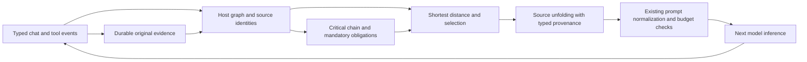

# Gary's 4tope: natural geometry for chat continuity and inference context

**Status:** design proposal and offline mathematical reference; no production Codex behavior changes.
**Origin:** Gary Stimpson framed and named Gary's 4tope on 2026-10-10; implemented in NL-Veil.
**Analysis date:** 2026-10-11.

This proposal offers Gary's 4tope as a dependency-aware context policy for Codex: preserve the evidence behind the current work, retrieve neighboring observations under a fixed budget, and lay those observations out without asking another model to paraphrase them. The intended benefit is a chat that continues from its actual work rather than repeatedly reconstructing that work after a context cut.

The immediate adoption point is Codex's **context manager and compaction retention policy**. Its influence on inference is through the input the harness supplies to the model. The public repository does not expose OpenAI's model weights, attention implementation, or serving scheduler; this proposal makes no claim to change those internals.

## 1. The problem in chat

A chronological transcript answers, "What happened recently?" A coding conversation also needs to answer, "What does this next action depend on?" Those are different questions. An old specification can still govern the current edit; a recent search result can be irrelevant; an unsuccessful command can explain why a tempting approach should be reconsidered; a later successful test can invalidate an earlier failure for one particular workspace revision.

For example, the user says, "Keep MAGIC_V2 support and do not deploy." The agent reads a parser, reads unrelated configuration, discovers a failing parser test, edits the parser, runs the test successfully, then reaches a context boundary. A useful continuation must retain the user constraint, the verified edit and test outcome, the current next action, and any still-relevant unsuccessful investigation. Its quality should not depend entirely on which of those appeared most recently or on a new model successfully writing a short summary.

4tope separates three operations:

1. **Protection:** identify a high-weight dependency chain that pruning should preserve.
2. **Selection:** find evidence nearest the current work in the graph, subject to a budget.
3. **Layout:** unfold the selected evidence into a readable sequence with source identity.

Protection and selection are separate policies. In the original implementation, protecting a result from one pruning pass does not guarantee that every later summary or small continuation can retain it.

## 2. What "natural geometry" means

Gary's framing is that a conversation contains relationships a single sequence of messages does not express well. The 4-polytope net is the organizing analogy: connected cells are unfolded along a tree so that a reader can see a useful flat view of a larger structure. In the chat application, the cells are work events, adjacency is recorded dependency, and the unfolding is the prompt.

The analogy motivates the design; the implementation is a graph algorithm. It does not assign physical four-dimensional coordinates, calculate polytope faces, prove a Euclidean embedding, or establish that every conversation is literally a 4-polytope. Graph shortest distance is a policy-defined relevance distance. It is not a measured distance in a geometric model of intelligence.

The precise useful statement is: a tree gives each reachable node one parent and permits a deterministic depth-first presentation without repeating nodes. A subtree occupies a contiguous traversal region. In a branching graph, **all original dependency paths cannot generally become simultaneously contiguous text**. Retained cross-edges and source IDs are therefore part of the design, even though only one tree controls layout.

## 3. The original graph

The authoritative implementation is [NL-Veil net.zig](https://github.com/gary23w/nl-veil/blob/a6b1b5d8c6e3a667e8d7436667b17ab16265fbda/src/worker/chat/net.zig). Its [module explanation](https://github.com/gary23w/nl-veil/blob/a6b1b5d8c6e3a667e8d7436667b17ab16265fbda/docs/docs-src/worker/chat/net.md) and [release evidence](https://github.com/gary23w/nl-veil/blob/a6b1b5d8c6e3a667e8d7436667b17ab16265fbda/docs/release/RELEASE-v1.1.16.md) describe the deployed intent.

Let the working span be a directed graph G=(V,E). Nodes are messages classified as user, assistant step with calls, assistant note, tool result, or engine message. Every dependency v→u points to an older node u, so chronological order supplies the order needed for dynamic programming. Let f be the newest assistant step or note: the **frontier**, where the work stands. Tool results may arrive after f and remain reachable through their issuing step.

| Dependency | Meaning | Longest-path weight w | Base traversal cost c0 |
| --- | --- | ---: | ---: |
| Result → issuing step | Matched by tool call ID | 1 | 1 |
| Step → reused previous-round result | Distinctive-token overlap in text or subsequent arguments | 2 | 1 |
| Step → previous assistant step/note | The assistant's chronological work thread | 1 | 1 |
| Step → other previous-round result | Available observation with no detected reuse | 0 | 3 |

These numbers serve different purposes. A large **w** makes a dependency more attractive to protection. A small **c0** makes it nearer for retrieval. Using a single weight for both would conflate two policies.

The reuse detector in the Zig implementation is a heuristic: at most 32 distinctive tokens, five or more characters and at most 64 characters, including letters, with common words removed. It compares those tokens against clipped previous-round result text. This is evidence of lexical reuse, **not proof that the model read, understood, or logically needed that result**. It cannot detect all older or semantically expressed dependencies.

The original implementation marks an older result superseded when a later result has the same tool name and clipped arguments, or a later recognized file operation names the same path. It detects failure from opening text patterns. These are practical NL-Veil rules, but they need stronger execution metadata in Codex.

## 4. Gary's formula, term by term

### 4.1 Protection: the longest weighted path

For every node v, compute:

```text
L(v) = 0                                         when deps(v) is empty
L(v) = max(0, max[L(u) + w(v,u) for u in deps(v)]) otherwise
```

L(v) is the greatest accumulated dependency weight while walking backward from v. Compute it oldest first; every referenced L(u) is already known. Record the maximizing predecessor pL(v), favoring the newer predecessor on equal positive scores. The original code does not choose a zero-weight-only predecessor when it has not already found a path.

Follow pL from f to obtain the critical chain C(f). The original pruning protection set is:

```text
P = { v in C(f) : v is a tool result and v is not superseded }
```

This recurrence takes O(|V|+|E|) time on a DAG. The general-graph longest-simple-path problem is not what this design solves.

**What it proves:** this is a longest path according to the chosen weights on the recorded DAG.
**What it does not prove:** that this one path contains every indispensable prerequisite. If a frontier needs both schema evidence and authentication evidence, one chain can choose only one branch. This proposal preserves the original formula and makes that limitation explicit rather than quietly redefining it.

For a production extension, define host-validated must-keep dependencies separately and preserve their dependency closure when feasible. The longest chain remains a ranking/protection signal. If the mandatory closure exceeds the window, invoke a documented fallback; do not pretend a bounded prompt can retain unlimited required evidence.

### 4.2 Carry: shortest distance from the frontier

For retrieval, traverse each recorded edge in both directions. Define the cost of entering node b from adjacent node a:

```text
c(a,b) = c0(a,b) + 4 * I[b is superseded] + 1 * I[b is failed]
d(f)   = 0
d(v)   = minimum sum of c(a,b) over all paths from f to v
```

I[condition] is 1 when the condition is true and 0 otherwise. All arc costs are positive, so Dijkstra's algorithm applies. Although adjacency can be traversed either way, the arrival penalties make c(a,b) and c(b,a) potentially different. The traversal is therefore accurately represented as two directed arcs per dependency, not as equal-cost undirected edges.

A strong reuse edge costs 1; a weak observation edge costs 3. A stale destination adds 4 and a failed destination adds 1. Failed evidence remains retrievable, but the distance penalty makes room for nearer current evidence. Superseded nodes can still be traversed as connectors; their payloads are excluded from the original carry.

The shortest-path predecessor pD(v) defines the tree used for layout. There is no universal claim that these hand-selected costs are optimal. They are an inspectable policy that can be tuned or falsified through ablation.

### 4.3 Budgeted selection and unfolding

The original Zig carry reserves space for NEXT (the frontier's last words), ON DISK (the engine's file ledger), and section framing. NEXT receives at most about one-third of the byte budget and ON DISK at most one-quarter. It then examines eligible observations in increasing d order, with newer nodes winning distance ties, admits those that fit, and skips oversized candidates. It does not solve a globally optimal knapsack problem.

```text
S := eligible mandatory context
for v in eligible optional observations sorted by (d(v), newer first):
    if serialized_cost(S union {v}) <= B:
        S := S union {v}
render selected failures under RULED OUT
render remaining observations by depth-first traversal of pD
```

Here B is the available carry budget. The **mandatory context** in this pseudocode is a proposed Codex addition: user obligations and exact required evidence. The original Zig unfolding does not automatically carry user nodes. In the supplied reference, the caller marks mandatory nodes with `required`; the graph algorithm does not infer user intent from text.

The original carry uses NEXT / ON DISK / RULED OUT / ESTABLISHED. "ESTABLISHED" should be understood as a retained observation, not an independent truth guarantee. "RULED OUT" is state-dependent negative evidence, not a permanent ban on retrying a command after conditions change.

## 5. Why this can improve chat design

| User-visible need | Design mechanism | Expected benefit and limit |
| --- | --- | --- |
| Keep an old fact that the current edit still needs | Dependency protection and distance from frontier | Relevant old evidence can outrank recent noise; dependency detection must be accurate. |
| Preserve exact paths, IDs and error messages | Source-backed excerpts instead of regenerated prose | Avoids paraphrase changes inside retained excerpts; selection can still omit necessary information. |
| Continue without repeating failed approaches | Failure records with call/state provenance | Makes negative evidence visible; a changed state can justify a retry. |
| Continue with the user's actual constraints | Independently pinned obligation records | Protects constraints such as "do not deploy" that lexical reuse may miss. |
| Explain why the agent thinks a fact is available | Persisted source IDs and dependency links | Reviewers can trace a retained observation to its original event. |
| Reduce interruption at a context cut | Local graph selection and rendering | Can avoid an extra model call on eligible paths; existing Codex token-budget mode already avoids summarization. |
| Preserve continuity across model providers | Harness-side policy and typed adapter | No embeddings/model summarizer required for the graph core; provider wire shapes and token accounting still differ. |

The stronger architectural claim is justified: **identity, execution state, and explicit dependencies are suitable subjects for deterministic harness code**. The broad empirical claim, "4tope is better than Codex compaction for every chat," is not established. Short conversational exchanges, implicit reasoning, ambiguous user intent, visual content and multiple concurrent goals may need other retention strategies or a hybrid with model compaction.

It is also not lossless compression of an entire chat. It is lossy selection with a goal of preserving exact source content where content is retained. The original implementation clips results to about 240 bytes, arguments to about 160 bytes, frontier text to about 700 bytes, normalizes whitespace and substitutes `?` for JSON Unicode escape sequences. Consequently, "no model paraphrase" is accurate; "every output byte is the complete unchanged source" is not. A Codex adapter should use typed strings, UTF-8-safe explicit spans and original item references.

## 6. Where it fits in Codex, with source evidence

The analysis is pinned to upstream [a07c8ebd57feedc4cf5dfe854c8e9101de54186b](https://github.com/openai/codex/commit/a07c8ebd57feedc4cf5dfe854c8e9101de54186b). The fork proposal is based on its existing main at b741e480e203f037ca726bc2a76d99a8e8668e66; this document references the newer upstream snapshot explicitly, rather than claiming the fork's runtime has already adopted its architecture.

| Codex seam inspected | Present behavior at the pinned revision | Proposed 4tope role |
| --- | --- | --- |
| [context_manager/history.rs](https://github.com/openai/codex/blob/a07c8ebd57feedc4cf5dfe854c8e9101de54186b/codex-rs/core/src/context_manager/history.rs#L507) | Records annotated items, exposes normalized prompt envelopes and tracks destructive replacement/version state. | Build a bounded graph from typed envelopes; key snapshots by history version; invalidate on replacement/fork/rollback. |
| [history/lib.rs](https://github.com/openai/codex/blob/a07c8ebd57feedc4cf5dfe854c8e9101de54186b/codex-rs/history/src/lib.rs#L59) | ResponseItemEnvelope preserves harness metadata, including retained sources, ownership and compaction compatibility. | Keep graph selection and provenance in host metadata; do not reconstruct trust from rendered prompt text. |
| [history/retained_source.rs](https://github.com/openai/codex/blob/a07c8ebd57feedc4cf5dfe854c8e9101de54186b/codex-rs/history/src/retained_source.rs#L1) | Host-owned retained identity/revision for original user/assistant evidence. | Reuse appropriate identities; design a distinct tool-observation provenance record rather than misusing a user source as a tool source. |
| [compact_remote_history.rs](https://github.com/openai/codex/blob/a07c8ebd57feedc4cf5dfe854c8e9101de54186b/codex-rs/core/src/compact_remote_history.rs#L70) | Trims function-call history to fit the compaction request and preserves grouped notices. | Apply graph protection before destructive output rewriting, with a strict total prompt budget and group integrity. |
| [compact_remote_v2_attempt.rs](https://github.com/openai/codex/blob/a07c8ebd57feedc4cf5dfe854c8e9101de54186b/codex-rs/core/src/compact_remote_v2_attempt.rs#L35) | Clones history, trims outputs, normalizes envelopes, carries metadata and attaches executed calls before the remote request. | Extract graph evidence before content is clipped; retain metadata through selection; do not separate item and metadata indices. |
| [compact_retained_tool_outputs.rs](https://github.com/openai/codex/blob/a07c8ebd57feedc4cf5dfe854c8e9101de54186b/codex-rs/core/src/compact_retained_tool_outputs.rs#L1) | Recognizes explicitly retained named client-authored function outputs without a matching call; retains them whole or drops them. | A possible output shape for eligible retained evidence, after maintaining the actual client/host ownership contract. Do not fabricate `client_authored` for arbitrary observations. |
| [compact_remote_v2.rs](https://github.com/openai/codex/blob/a07c8ebd57feedc4cf5dfe854c8e9101de54186b/codex-rs/core/src/compact_remote_v2.rs#L499) | Builds retained history with a token budget, selects newest groups first, retains notices/metadata/images, appends the remote compaction item. | Use dependency ranking for eligible evidence while leaving the opaque compaction item intact. Initially supplement retention instead of replacing server compaction. |
| [session/mod.rs: start_new_context_window](https://github.com/openai/codex/blob/a07c8ebd57feedc4cf5dfe854c8e9101de54186b/codex-rs/core/src/session/mod.rs#L4658) | Retains eligible client outputs/developer messages under a budget, rebuilds initial/world-state context and installs a fresh window. | The clearest later experiment for a local source unfolding, using the existing replacement lifecycle. |
| [compact_token_budget.rs](https://github.com/openai/codex/blob/a07c8ebd57feedc4cf5dfe854c8e9101de54186b/codex-rs/core/src/compact_token_budget.rs#L16) | Already skips model/server summarization and emits ordinary compaction lifecycle events/hooks. | Compare dependency-selected carries against this existing zero-summary path. Zero model calls alone is not a new Codex capability. |
| [compact.rs](https://github.com/openai/codex/blob/a07c8ebd57feedc4cf5dfe854c8e9101de54186b/codex-rs/core/src/compact.rs#L259) | Local model-generated summaries retain user messages and restore canonical initial/world-state context. | Keep as fallback or hybrid for spans whose important information cannot be safely represented by graph evidence. |
| [context_manager/normalize.rs](https://github.com/openai/codex/blob/a07c8ebd57feedc4cf5dfe854c8e9101de54186b/codex-rs/core/src/context_manager/normalize.rs#L21) | Repairs missing call outputs and removes orphan outputs for supported call families. | Select valid groups or an explicitly supported standalone retention shape; do not let normalization silently erase selected evidence. |
| [session/turn.rs](https://github.com/openai/codex/blob/a07c8ebd57feedc4cf5dfe854c8e9101de54186b/codex-rs/core/src/session/turn.rs#L1435) | Routes automatic compaction through token-budget, remote V2 or local paths according to capabilities/features. | Place experiments behind a capability-aware flag; exercise every eligible path, rather than patching only one compaction function. |

This is a fit analysis, not a report of defects in those modules. It identifies the contracts a runtime implementation would need to preserve.

## 7. Chat and inference are connected through the harness



The model still reasons and generates. The harness decides which externally observed facts and instructions are available for that reasoning. On a successful carry, the model receives less irrelevant history and more task-adjacent evidence. That can plausibly reduce redundant file reads, repeated failed calls and incorrect continuation. It does not by itself improve the model's mathematical reasoning capacity, guarantee correct answers, or preserve private/opaque reasoning state.

OpenAI's [compaction documentation](https://developers.openai.com/api/docs/guides/compaction) distinguishes server-side compaction and the standalone compact endpoint. Its returned compaction state is opaque. A 4tope experiment must treat opaque items as indivisible provider state and follow the endpoint's output contract. In particular, the standalone compact endpoint's returned window is canonical; it must not be manually pruned. Client-side retention should operate within supported Codex assembly paths, not by interpreting or altering encrypted content.

Tree ordering may improve local readability, but changing prompt prefixes can reduce prompt-cache reuse. Selection must therefore report **net** request/latency effects, including cached tokens and subsequent re-reads, rather than equating fewer carry bytes with lower total inference cost.

## 8. Required adaptations before production integration

1. **Typed graph ingestion.** Use ResponseItemEnvelope and actual tool execution events, not substring scans over comma-joined JSON. Preserve full arguments and exact source identity before clipping. Pair calls by namespaced call ID. Distinguish instructions, quoted source content, tool observations, engine state and agent messages.
2. **Explicit obligations.** Pin current human request, accepted corrections, pending approvals and relevant constraints in their existing authority channels. Preserve original role/source and inheritance boundaries; a remembered assistant statement or another agent's message cannot acquire user authorization through selection.
3. **Branch completeness.** A single maximum-weight path is insufficient when two branches matter. Preserve verified must-keep closure or a bounded collection of relevant chains; record omissions explicitly. Do not call a weak lexical edge a logical requirement.
4. **State-aware supersession.** A newer failed read does not supersede an earlier successful read merely because the path matches. A command can return different results after a file/environment change. Compare workspace revision/content hash, normalized full arguments, execution status, scope and observation time. Preserve causally useful failure history without presenting it as the current state.
5. **Exact provenance and clipping.** Carry source item ID, role, tool name, call ID, revision and explicit excerpt offsets/completeness. If shortened, invoke existing metadata incompleteness handling. Do not retain delivery/completeness proof for text that was omitted. RetainedSourceRole currently covers user/assistant; tooling needs a proper observation identity rather than an invented role substitution.
6. **Protocol-valid output.** Maintain call/output pairs and attached notices when replaying protocol history. Where a supported standalone retained output is appropriate, preserve its metadata and ownership semantics. Rendered evidence remains data; it must not become a fresh developer instruction merely because the engine printed it.
7. **Real budget accounting.** Charge the active provider's token representation, framing, tool definitions, notices, images, opaque state and output headroom. Byte counts are an offline fixture convenience, not a general token bound. If mandatory evidence cannot fit, return an explicit fallback reason without partially replacing history.
8. **Durability and lifecycle.** Use existing history/replacement/rollout machinery for atomic installation and recovery. Rebuild or invalidate graph caches on rollback, fork, history version changes and model switches. Track opaque compaction producer compatibility. The original source is recoverable only while the configured retention policy retains it; the proposal does not promise indefinite storage.
9. **Concurrency and freshness.** Snapshot history version before constructing the graph; recheck before installation. Incorporate queued user steering or retry against the changed snapshot. Tool outputs from different branches need thread/turn namespaces, and agent summaries remain advisory evidence.
10. **Bounded cost.** Maintain forward/reverse adjacency once and use heap Dijkstra for larger spans. The original reverse-edge lookup scans all edges per settled node, so its worst case is O(V²+VE), even though its source comment describes the minimum-selection portion as O(V²). The original graph construction also has pairwise work. The whole pipeline must be benchmarked, not described as uniformly linear.

The original shortest-tree walk stores only 64 children per node; excess children can fail to render. It also estimates byte costs before emitting rows, with a separately generated fallback NEXT string. A production adaptation should use dynamic bounded adjacency and verify final serialized cost. These observations concern porting completeness, not a reason to discard the graph approach.

## 9. Related applications inside the harness

- **Task/agent handoff:** unfold each branch's dependencies with provenance and original user-scope boundaries. Reconcile conflicting observations before declaring a shared fact current.
- **Resume after a long gap:** reconstruct graph state from retained typed events, then revalidate mutable file state. Do not rely on a saved "ON DISK" label as proof that disk contents have not changed.
- **Tool discovery:** Gary's sibling tool tree in [belt.zig](https://github.com/gary23w/nl-veil/blob/a6b1b5d8c6e3a667e8d7436667b17ab16265fbda/src/worker/chat/belt.zig) gives bounded views of a large tool catalogue. It is a separate candidate experiment with schema/discovery contracts; it should not be bundled into the initial context-retention change.
- **Memory/retrieval:** retain graph source pointers and selected observations under Codex's existing storage policies. NL-Veil's neuron-db persistence is not a prerequisite or a proposed new Codex dependency.
- **Inspection UI:** show why an observation was selected and which source supplied it. The graph should improve user understanding without filling ordinary chat with mathematical diagnostics.

## 10. Reference implementation included with this proposal

[reference.rs](gary-4tope/reference.rs) is a dependency-free Rust experiment implementing the longest-chain recurrence, heap shortest-path tree, distance-ordered byte selection and deterministic source layout. It accepts **caller-built typed fixture nodes**. It does not implement the Codex adapter, token-overlap extraction, failure detection, supersession inference, provider serialization, durable storage, image handling or a production tokenizer.

The reference intentionally adds caller-pinned obligations, exact final UTF-8 byte accounting, explicit oversized-mandatory fallback, dynamic children and graph-size bounds. These are disclosed porting adaptations. They do not redefine Gary's two graph equations. Graph costs/weights retain the original values; layout tie-breaking is explicitly deterministic.

The returned source IDs are local fixture indices, not persisted Codex identities. The plain-text renderer is an **inspection output**, never an automatically safe replacement for protocol messages. In particular, a test confirming literal untrusted text is preserved does not certify prompt-injection resistance; the production role/provenance adapter needs separate tests.

From the directory containing the reference:

```powershell
rustc --edition 2024 --test reference.rs -o reference-tests.exe
.\reference-tests.exe
```

On Linux/macOS, use `-o reference-tests` and `./reference-tests`.

The reference passed **12 offline tests** with rustc 1.96.0 on Windows. They cover weighted-chain choice, stale-result filtering, asymmetric penalties, results produced by the frontier, disconnected pinned obligations, failure presentation, exact budget fallback across 1,400 budgets, oversized optional evidence, UTF-8/literal content, cycle rejection, 100-child fanout, deterministic layout and the one-chain/multiple-prerequisite limitation.

No full Codex build, model-backed replay or comparative quality/latency benchmark was run. The NL-Veil release notes report scripted end-to-end continuation and explicitly say hosted-model long-task continuation was not yet verified. Those results are evidence for NL-Veil's mechanism, not a benchmark proving superiority in Codex.

The reference's [MIT license](gary-4tope/LICENSE) preserves the original project's notice. The proposal attributes the concept to Gary Stimpson and does not claim that longest-path dynamic programming or Dijkstra's algorithm themselves are new.

## 11. Evaluation and adoption plan

**Phase A: shadow selection.** Add a proposed, default-off experiment flag; calculate selections from the same snapshot without changing the request. Compare selected sources against expert-labeled task prerequisites and detect omissions, unsafe state substitutions and cost overruns.

**Phase B: retention experiment.** Change only eligible evidence retention within existing lifecycle/protocol contracts. Initially keep the remote opaque compaction state and ordinary canonical context. Compare against both existing remote/local compaction and token-budget window reset on matched tasks and budgets.

**Phase C: local carry/hybrid.** Only after adapter and replay evidence, allow a fully local carry for supported spans. Retain model compaction where semantic synthesis or opaque reasoning continuity is needed. Fall back atomically on incompatible item families, unknown provenance, invalid DAGs, budget overflow, changed history versions or unsupported provider behavior.

| Evaluation family | Measurements |
| --- | --- |
| Old dependency vs recent noise | Essential-source recall/precision and exact identifier retention at matched budgets. |
| Multiple necessary branches | Required closure omissions; schema/auth and concurrent-tool fixtures. |
| Failed/successful retries | Unnecessary repeated calls, correct retries after state changes, stale-success/stale-failure substitutions. |
| Human steering and authority | Correct handling of "do not deploy", revoked permission, edits after snapshot and inherited agent evidence. |
| Long chat/model/provider changes | Completion quality, continuation correctness, replay/resume consistency and opaque-state compatibility. |
| Performance | Graph construction/selection p50 and p95, total input/output/cached tokens, compaction calls, later re-reads, end-to-end latency and memory. |
| Nontext/tool protocol | Images, long outputs, notices, custom calls, missing results, unknown item families and source completeness. |

Ablate lexical reuse, critical-chain protection, distance ranking, failure retention, state-aware supersession and tree layout independently. Compare equal **total context budgets** and equal tasks, not a smaller 4tope prompt against an unrestricted baseline. Publish measured tradeoffs and regressions before changing a default.

Suggested acceptance conditions are zero authority/pairing violations in deterministic fixtures, no silently omitted mandatory evidence, reproducible budget compliance, improved prerequisite recall or task continuation at matched budgets, and a measured acceptable p95 overhead. Numeric thresholds should be agreed against representative Codex workloads rather than invented in advance.

## 12. Contribution route

Codex's current [contribution guide](https://github.com/openai/codex/blob/a07c8ebd57feedc4cf5dfe854c8e9101de54186b/docs/contributing.md) says it does not accept external code contributions or pull requests and welcomes analysis/design discussion in issues. This proposal is therefore reviewable as a draft PR in Gary's Codex fork, with an upstream design issue linking to it. It is an offer for maintainer-led evaluation and implementation, not an assertion that OpenAI has accepted or merged it.
